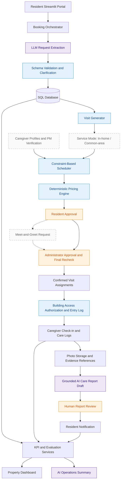
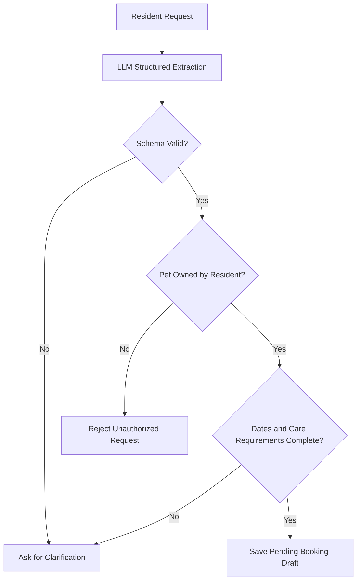
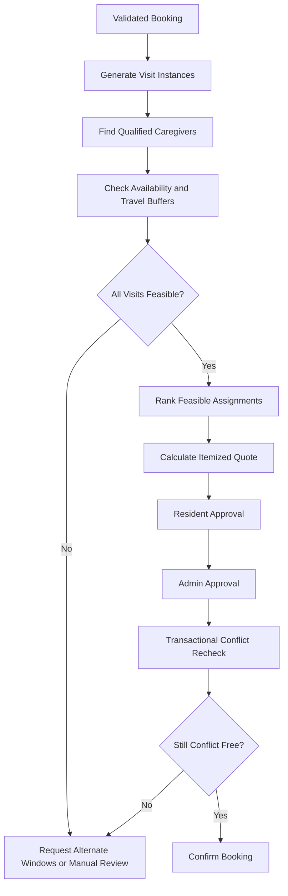
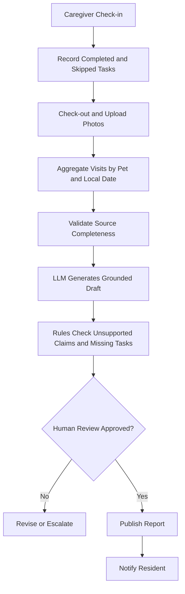
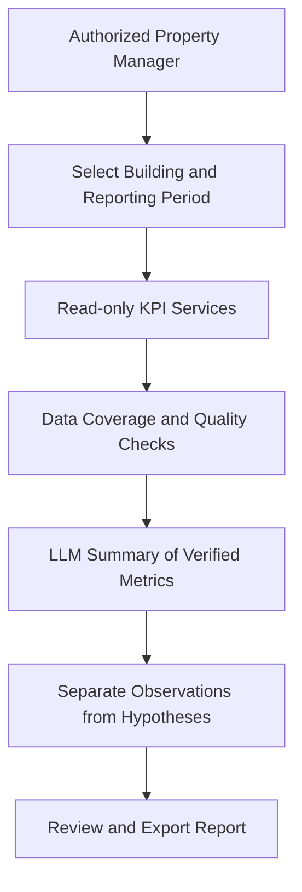
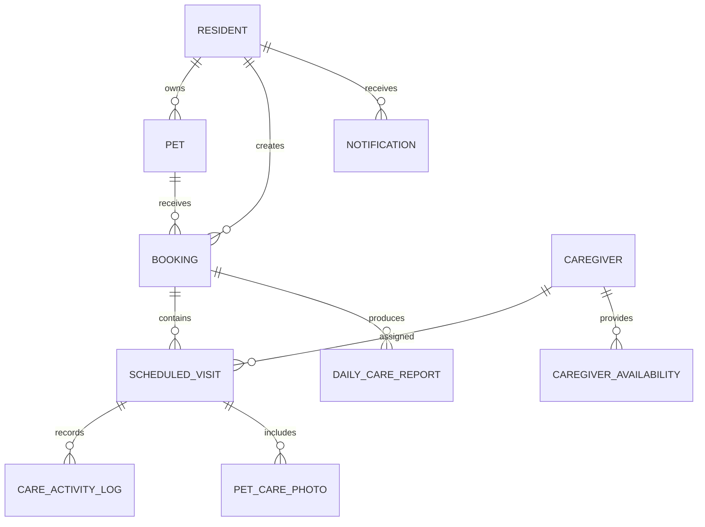
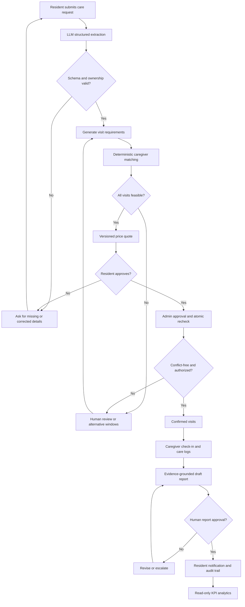
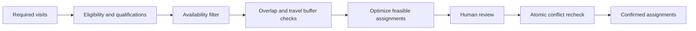

# PawPal AI
## AI-Powered Pet Concierge & Care Operations Platform
 
**Stage:** MVP development / concept validation  
**Audience:** Property managers, prospective pilot partners, developers, recruiters, and early-stage investors  
**Status disclaimer:** This document describes the proposed product architecture and business model. Individual features must be verified against the repository before being labeled implemented. All pricing and financial examples are illustrative assumptions, not actual operating results.

> **Vision:** Enable residents of premium multifamily buildings to travel with peace of mind while their pets receive trustworthy, documented care in the comfort of their own homes.

## 1. Executive Summary

PawPal AI is a proposed B2B2C pet-care coordination platform for luxury apartment buildings. Instead of relocating pets to boarding facilities, residents request approved in-home care through their building's resident experience. Trained caregivers perform scheduled visits, log activities, and upload photos. AI assists with interpreting requests, drafting reports, and summarizing operational performance; deterministic software validates schedules, pricing, permissions, and approvals.

PawPal AI seeks to make in-home pet care a repeatable residential amenity. Its initial commercial hypothesis is that property managers will value a differentiated amenity that does not require their own staff to deliver pet care, while residents will value convenience, trusted access procedures, and transparent updates. Neither hypothesis is yet validated.

**Initial geography:** Jersey City, Hoboken, Manhattan, and Brooklyn.  
**Initial offering:** Scheduled cat visits and eligible dog-care visits, subject to an individual pet's needs and appropriate caregiver coverage.  
**Initial go-to-market:** One-building pilot, followed by a small cluster of buildings to improve caregiver density.

## 2. Problem, Customers, and Value Proposition

### Core insight

Pet care in New York’s luxury apartment buildings is not a supply problem. It is a trust and access problem. Residents hesitate to let strangers into their homes, and building management bears the operational and security burden of outside caregivers coming and going. Existing marketplaces such as Rover and Wag solve for finding a caregiver but leave both problems unaddressed. By partnering directly with buildings, PawPal turns pet care from an external risk the building has to manage into an amenity the building can offer.


### Resident pain points

NYC’s renter inflow skews young: Gen Z and millennials made up over 80% of people moving to the city in 2021–2022 (U.S. Census Bureau, via Fortune), and in the buildings I observed, residents were predominantly students and young professionals. These newcomers often travel frequently and lack a local support network to care for their pets. Meanwhile, close to 60% of U.S. renters now own a pet, up from under 50% a few years earlier (Zillow).

- Boarding or leaving pets with friends can be stressful for pets accustomed to a familiar environment.
- In-home care solves this but requires letting a stranger into the home, and sourcing an independent sitter and coordinating building access is cumbersome.
- Residents want clear proof of completed care and timely updates while traveling.
- A failed or missed visit can create an animal welfare issue, not merely an inconvenience.

### Property manager pain points
- Outside caregivers entering frequently add to the workload in visitor registration, key handoffs, and liability for safety incidents [add interview findings if available].
- Management teams need clear access rules, escalation paths, and service accountability.
- Building staff may not have the training, time, or insurance coverage to provide pet care themselves.
Residents increasingly expect differentiated services and convenient amenities.

### Three-sided value proposition
| Stakeholder | Proposed value | Critical trust requirement |
|---|---|---|
| Resident | In-home care, convenient booking, updates, visible service records | Explicit consent, secure access, transparent care logs |
| Caregiver | Clear tasks, schedules, and standardized reporting | Fair compensation, realistic routing, safe working conditions |
| Property manager | Building-integrated amenity and operational visibility | Low management burden, approved vendors, incident protocols |

**Positioning:** *Pet Concierge as a Residential Amenity*, not simply another consumer pet-sitting marketplace.

## 3. Product Scope and User Journeys

### Resident journey
1. Select resident profile and authorized pet.
2. Describe needs in natural language.
3. Review extracted requirements; clarify missing or ambiguous details.
4. Select visit windows and review a rule-based quote.
5. Approve the proposal; wait for administrator confirmation.
6. Receive visit-status updates and reviewed care reports.

### Caregiver journey
1. Maintain availability and service qualifications.
2. Review confirmed assigned visits.
3. Check in, perform care, record actual activities, and check out.
4. Upload relevant photos and factual notes.
5. Submit care records for report generation and review.

### Property manager / operator journey
1. Configure building rules, authorized personnel, and service coverage.
2. Review caregiver recommendations and unresolved conflicts.
3. Approve or reject proposed assignments.
4. Monitor missed visits, incidents, pending reports, and service KPIs.
5. Review monthly analytics and staffing recommendations.

### Service Modes and Care Verification

Building CCTV in New York is generally not accessible to residents. Landlords and property managers are not obligated to share footage outside of a legal process such as a police request or court order, and access is typically limited to the security firm, property manager, and superintendent. PawPal therefore does not rely on building footage to prove care quality, and instead offers two service modes with a layered verification approach.

### Service modes

- In-home care (default): Caregivers visit the resident’s unit. Recommended for cats and pets sensitive to unfamiliar environments.
- Common-area care (optional): Walks, play, and exercise take place in the building’s pet amenity spaces, so no unit entry is required. Best suited for dogs. Shared-space use follows building rules, such as vaccination records and scheduled time slots to avoid pet-to-pet conflicts.

### Verification layers

1. Platform records (all visits): Check-in and check-out timestamps, photos, and structured care logs, reviewed before reports are sent to residents.
2. Resident home cameras (optional): Many owners already use pet cameras. Caregivers are informed in their service agreement that units may contain video and audio recording devices, and consent is obtained in writing. This keeps resident monitoring consistent with New York’s audio recording laws, which prohibit recording a conversation without the consent of at least one party.
3. Building CCTV (incidents only): For common-area visits, footage remains under property management control and is reviewed under the building’s existing access policy if an incident occurs.


## 4. End-to-End Architecture



**Legend:** Purple = LLM components · Blue = deterministic rules · Orange = human approval · Dashed = planned

### Design principles

- **LLMs are bounded to language tasks.** They extract structured requests and draft care reports; they never assign caregivers, set prices, or confirm bookings.
- **Decisions with financial or safety impact are deterministic.** Scheduling, matching, and pricing use rule-based engines that are reproducible and testable.
- **Humans approve at every point of commitment.** Residents approve the proposal, administrators approve the assignment with a final conflict recheck, and staff review AI-drafted reports before residents see them.
- **Reports are grounded in evidence.** AI care reports are generated only from recorded check-ins, care logs, and photo references, not from free-form generation.

## 5. Agent 1 — Natural Language Booking Agent

**Business function:** Convert a resident's free-text request into a validated booking draft.

**Input:** Resident-selected pet, message, local building timezone, current date.  
**Output:** Structured draft with `pet_id`, `start_date`, `end_date`, `visits_per_day`, `visit_windows`, `service_type`, `duration_minutes`, `special_instructions`, `photo_updates_required`, and `missing_fields`.



**Algorithm:**
1. Resolve the pet from an authenticated resident's own pet records; do not trust an LLM-provided owner ID.
2. Request Pydantic-constrained structured output from the LLM.
3. Normalize dates relative to the building timezone and a known reference date.
4. Reject invalid ranges and unsupported service types; flag ambiguity rather than guessing.
5. Persist a draft with source text, extraction version, and validation results.

**Evaluation:** Field-level exact-match accuracy, booking exact match, missing-field recall, invalid-date detection, and clarification rate. Build a labeled benchmark of at least 100 synthetic requests, including ambiguous dates and contradictory instructions.

## 6. Agent 2 — Scheduling and Pricing Coordinator

This is an **agent-assisted workflow**, with the core scheduler and price calculator implemented as deterministic algorithms rather than free-form LLM decisions.

### Scheduling entities
`CaregiverAvailability`, `CaregiverTimeOff`, `CaregiverCapability`, `ScheduledVisit`, and `BookingApproval` supplement resident, pet, caregiver, and booking records.

### Hard constraints
- Caregiver is authorized, active, and qualified for the pet and service.
- The full visit fits inside an available working interval.
- No overlap with another assigned visit or approved time off.
- Required travel buffers are respected between buildings.
- Visit falls within a resident-approved time window.
- All visits have assignments before final confirmation.

### Optimization objective
For a feasible assignment set, minimize a weighted cost:

\[
\min \sum_{v,c} x_{vc}(\alpha\,T_{vc}+\beta\,O_{vc}+\gamma\,R_{vc})
\]

where `x_vc` is 1 if visit `v` is assigned to caregiver `c`, `T` is travel minutes, `O` is overtime penalty, and `R` is a reassignment or preference penalty. Weights are configurable business assumptions. Infeasible assignments are prohibited by hard constraints rather than penalized.



### Illustrative pricing rules
| Item | Assumed price |
|---|---:|
| Cat visit, 30 minutes | $30 |
| Dog visit, 30 minutes | $35 |
| Upgrade from 30 to 60 minutes | +$15 per visit |
| Additional care service | +$10 per visit |

`Quote = Σ(base_visit_rate + duration_addon + selected_addons)`. Use decimal arithmetic and versioned pricing rules; these rates are examples for testing, not market-validated prices. An inclusive four-day booking with two 30-minute cat visits per day would contain eight visits and a **$240 illustrative quote** before any additional fees.

**Safety:** Final approval requires both resident and administrator consent, complete caregiver assignments, and a fresh conflict check. SQLite has limitations under concurrency; production scheduling should use PostgreSQL transactions and suitable locking/constraints.

## 7. Agent 3 — Grounded Care Reporting Agent

**Business function:** Draft trustworthy daily care summaries from visit execution records, not imagined activity.

**Inputs:** Actual check-in/out timestamps, activity logs, caregiver notes, photo references, missing-visit flags.  
**Outputs:** Daily report draft, cited source record IDs, unresolved issues, review status.



**Critical rules:** A photo does not prove feeding or medication administration. A missing activity record must never be described as completed. AI must not diagnose medical conditions. Missed essential care tasks or unusual observations require human escalation according to documented protocols.

**Evaluation:** Unsupported factual claim rate, missing-activity recall, report completeness, human correction rate, and time-to-report. A rule-based evaluator and manually checked samples are primary; an LLM judge is supplementary.

## 8. Agent 4 — Property Operations Insights Agent

**Business function:** Translate verified operational metrics into concise, actionable property management summaries.

**Input:** Read-only, permission-scoped KPI service results.  
**Output:** Period-specific observations, evidence references, caveats, and recommended follow-up actions.



The agent cannot execute arbitrary SQL, access another building's data, or invent explanations for observed changes. Forecasting and staffing suggestions must be labeled as estimates.

### KPI definitions
| Metric | Definition | Notes |
|---|---|---|
| Booking conversion | Confirmed bookings / valid booking requests | Define cohort and cutoff |
| Visit completion | Completed visits / visits due | Exclude future visits |
| Scheduling conflict | Attempts with conflict / scheduling attempts | Requires attempt logging |
| Caregiver utilization | Assigned care minutes / available care minutes | Specify paid/unpaid time treatment |
| Gross booking value | Sum of eligible confirmed quote amounts | Not the same as net revenue |
| Extraction field accuracy | Correct evaluated fields / total evaluated fields | Against human-reviewed labels |
| Unsupported claim rate | Unsupported claims / factual claims reviewed | Manual verification sample |
| Processing time | Confirmation timestamp − creation timestamp | Report median and distribution |

Do not display a percentage when the denominator is zero. Clearly label synthetic demonstrations and small samples.

## 9. Optional Algorithm — Demand Forecasting and Capacity Planning

After collecting enough actual history, predict daily visit demand by building using historical averages, Poisson regression, and potentially gradient-boosted models. Candidate features include day of week, holidays, seasonal travel periods, active pet-owning households, and past bookings.

**Validation:** Use chronological train/test splits and rolling-origin backtesting, not random splitting across time. Compare MAE and WAPE against a seasonal naive baseline. Convert expected visit counts into caregiver-hour requirements using observed service duration and travel buffers. Never claim predictive performance from synthetic data is evidence of real-world accuracy.

## 10. Data Model and Trust Boundaries



**Access control:** Residents access their own pet and booking records; caregivers access assigned visits; managers see only authorized building operations. Sensitive medical notes should be restricted to personnel who require them for care. Role checks must be enforced in backend services, not merely hidden in UI elements.

**Auditability:** Record booking state transitions, approval actors and timestamps, caregiver activity edits, report generation versions, and notification outcomes. Use least-privilege access and configurable retention policies.

## 11. Business Model and Unit Economics

### Options to validate
1. **Transaction fee:** Platform retains a share of each completed booking; simplest pilot model if caregiver operations are outsourced.
2. **Building SaaS fee:** Building pays for management and resident experience; needs strong proof of property-level value.
3. **Hybrid:** Small monthly building subscription plus transaction fee; potentially appropriate after repeat demand is demonstrated.
4. **White label:** Enterprise licensing to property operators; longer sales cycle and greater implementation burden.

**Recommended pilot hypothesis:** Begin with a transaction-based model and no large fixed building commitment, subject to insurance, access approval, and viable caregiver margins. Test whether buildings will endorse the service and whether residents actually book.

### Illustrative monthly unit economics — one building
Assumptions: 300 units × 30% pet-owning units × 20% monthly buyer adoption × $180 average monthly gross bookings per buying unit.

| Metric | Illustration |
|---|---:|
| Pet-owning units | 90 |
| Monthly buying units | 18 |
| Gross bookings | $3,240 |
| Platform take rate (assumed) | 20% |
| Platform gross revenue | $648 |

This is **not profit**. It excludes processing, insurance, support, refunds, acquisition, software, and any operational costs borne by the platform. If PawPal employs caregivers directly, the accounting and margins differ materially. A real pilot must determine which party contracts with, pays, and insures caregivers.

### Scenario design
Build conservative, base, and optimistic cases by varying pet ownership, adoption, purchase frequency, average order value, platform take rate, and costs. Avoid extrapolating from one pilot building without confidence intervals or sensitivity analysis.

## 12. Market Opportunity and Competition

**Market hypothesis:** Premium multifamily buildings with concentrated pet-owning households could reduce acquisition and travel friction compared with acquiring individual consumers across a city.

**Competitive set:** Consumer marketplaces (e.g., Rover and Wag), independent pet sitters, boarding facilities, pet concierge companies, and building amenity vendors. The underlying service is not new. Differentiation must come from building integration, reliable service execution, verified reporting, and operational efficiency.

### Research still required
- Verified local counts of eligible pet-friendly buildings and units.
- Local resident willingness-to-pay and travel frequency.
- Building manager interest, insurance/access requirements, and vendor procurement process.
- Current local sitter and boarding pricing.
- Competitor partnerships and contractual models.

**TAM/SAM/SOM approach:** Estimate addressable units × pet ownership × annual care spending for the total market; restrict SAM to reachable luxury multifamily buildings in the launch geography; base SOM on realistic signed buildings, resident adoption, and operational capacity. Do not insert unsupported market-size figures.

## 13. Go-to-Market Strategy

### Phase 0 — Discovery (before launch)
Interview 20–30 residents and 5–10 property managers. Validate travel frequency, pet-care pain points, access approval, willingness to pay, and perceived trust barriers. Conduct caregiver interviews and review local insurance requirements.

### Phase 1 — One-building pilot
Choose a pet-friendly building with a willing manager, a manageable number of pets, and a vetted care partner. Begin with clearly defined services and emergency escalation procedures. Collect booking conversion, completion, customer feedback, operational effort, and contribution margin.

### Phase 2 — Building cluster
Expand to 3–5 nearby buildings if the pilot meets thresholds. Concentrate caregivers geographically, standardize building onboarding, and test referral channels.

### Phase 3 — Regional expansion
Only after proving repeat demand, service quality, unit economics, and insurance/access compliance, pursue larger property management groups and white-label options.

### Pilot exit criteria (proposed, not achieved)
- Zero unresolved safety-critical incidents.
- All scheduled visits either completed or escalated under a documented response process.
- Positive per-booking contribution margin after variable costs.
- Evidence of resident repeat use and property manager willingness to renew.
- Auditable report and notification performance.

## 14. Safety, Compliance, and Operational Risk

| Risk | Mitigation |
|---|---|
| Unauthorized unit access | Explicit resident consent, verified caregivers, secure access procedures, access logs |
| Missed or inadequate care | Escalation coverage, task checklists, missed-visit alerts, backup caregiver protocol |
| Pet illness or emergency | Preauthorized emergency contacts, veterinary instructions, human escalation; no AI diagnosis |
| Liability and insurance | Review pet-care, general liability, property, workers' compensation, and local requirements with qualified advisors |
| Scheduling collision | Transactional rechecks, unique assignments, concurrency tests, human override with audit trail |
| AI hallucination | Structured inputs, evidence-linked reports, rule-based checks, human review |
| Privacy and security | Least privilege, restricted photos, secrets management, retention policy, encryption as appropriate |
| Weak unit economics | Track contribution margin by visit/building and travel-time utilization |

Legal, licensing, insurance, employment classification, and animal welfare requirements vary by jurisdiction and must be verified before a live pilot.

## 15. Four-Week MVP Roadmap

| Week | Scope | Evidence of completion |
|---|---|---|
| 1 — Booking Foundation | Database, synthetic records, structured request extraction | Validated booking draft saved and retrieved |
| 2 — Scheduling & Pricing | Availability, conflict checks, visit generation, quotes, approvals | Feasible schedule and correct quote; no double booking |
| 3 — Care Reporting | Check-in/out, activity logs, photos, reviewed AI report, notifications | Report grounded in actual recorded events |
| 4 — Analytics & Evaluation | KPI dashboard, benchmarks, operational alerts, insights | Reproducible metrics and documented test results |

**Implementation status:** Verify each milestone against tests and screenshots in the repository. A roadmap entry does not prove the feature has been implemented.

### Post-MVP priorities
- Authentication and tenant isolation hardening.
- PostgreSQL migration and concurrency-safe scheduling.
- Professional caregiver partner onboarding and insurance verification.
- Pilot-grade incident handling and consent workflows.
- Real-world evaluation with a limited building pilot.
- Demand forecasting only after sufficient longitudinal data exists.

## 16. Experiment and Evaluation Plan

### Booking extraction benchmark
Prepare 100+ manually labeled synthetic requests spanning simple, ambiguous, multi-pet, and invalid scenarios. Report field-level accuracy with sample counts and confidence intervals when appropriate. Include examples of failures.

### Scheduling benchmark
Generate reproducible availability and conflict scenarios. Test zero hard-constraint violations, assignment coverage, runtime, and travel-time cost relative to a naive feasible baseline.

### Reporting benchmark
Use source-grounded synthetic visit logs with intentional omissions. Count factual claims, unsupported claims, and missed issues. Manually review a subset and document reviewer agreement if multiple reviewers are used.

### Operational pilot
Measure actual conversion, completed visits, intervention time, resident satisfaction, and per-booking contribution margin. Compare automation-assisted processing time against a defined manual baseline, rather than claiming savings without measurement.

## 17. GitHub Repository Guide

Suggested structure:

```text
pawpal-ai/
├── README.md
├── app.py
├── src/
│   ├── models/
│   ├── services/
│   │   ├── booking.py
│   │   ├── scheduling.py
│   │   ├── pricing.py
│   │   ├── reporting.py
│   │   └── analytics.py
│   └── agents/
├── tests/
├── docs/
│   ├── BUSINESS_PLAN.md
│   ├── ARCHITECTURE.md
│   ├── EVALUATION.md
│   └── PRODUCT_ROADMAP.md
├── .env.example
└── requirements.txt
```

This is an illustrative target structure; align it with the actual codebase rather than renaming files unnecessarily.

**README opening:**

> PawPal AI is an in-development AI-assisted pet concierge and care operations platform for luxury residential buildings. It explores natural-language booking, constraint-based caregiver scheduling, grounded care reporting, and property operations analytics. This repository contains a prototype and its proposed business and technical design; implementation status is documented feature by feature.

**Publishing checklist:** Remove `.env`, keys, private data, uploaded photos, and local databases; verify links and Mermaid rendering; include setup steps, synthetic data disclosures, test commands, current limitations, and a clear license decision. Confirm that the name and branding are available before commercial launch.

## 18. Key Decisions and Open Questions

1. Will PawPal employ caregivers, contract directly with independent caregivers, or integrate with a licensed provider?
2. Which pet types and care schedules can be supported safely at launch?
3. Who holds the contractual relationship with residents, and who is responsible for insurance and incidents?
4. What building access mechanisms are acceptable to management and residents?
5. Does the property receive a referral commission, pay SaaS fees, or simply endorse the service?
6. What evidence will convince a property manager to authorize a pilot?
7. Which metrics will be required before expansion to a second building?

## 19. Conclusion

PawPal AI's potential lies in **operationally reliable building-integrated pet care**, with AI reducing coordination and reporting effort rather than replacing caregiver judgment. Its differentiator must be validated through safe service delivery, building partnerships, resident trust, and sustainable unit economics. The proposed technical architecture offers a testable path from an AI booking prototype to a measurable, auditable operations platform.

---

*Prepared as a concept-stage, GitHub-ready business and technical design. Market assumptions, prices, architecture choices, and feature status should be updated as evidence and implementation evolve.*


---

# Part II — Startup Business Plan & GitHub Documentation: Evidence, Assumptions, and Validation

**Research checkpoint:** October 2026. **Evidence hierarchy:** primary published sources > named competitor product pages > founder assumptions. Links should be rechecked before external fundraising. The project is an MVP concept, not an operating pet-care business. This section makes the commercial hypotheses and proposed algorithms auditable.

## 20. What Is Proven, What Is Proposed, and What Is Unknown?

| Claim | Status | Basis / verification path |
|---|---|---|
| Americans spend substantially on pets | **Externally supported** | APPA reports $158B total U.S. pet spending in 2025; this is **not** the addressable market for this service [S1]. |
| Home visits and photo updates are an existing customer proposition | **Externally supported** | Rover offers drop-in visits, house sitting and photo updates [S2, S3]. |
| Luxury buildings can partner with professional pet-care providers | **Externally supported as precedent** | Brooklyn Bark advertises luxury residential building partnerships [S4]. This does not establish the prevalence or profitability of such partnerships. |
| Pet owners should always prefer staying at home to boarding | **Not established** | Care needs vary by animal. AVMA discusses pet sitters and boarding as options, not a universal ranking [S5]. |
| Residents will pay a premium for building-integrated care | **Hypothesis** | Interview and price-test residents in target buildings. |
| Property managers will promote the amenity | **Hypothesis** | Obtain pilot letters of intent and signed access/operations protocols. |
| AI lowers administrative cost without compromising care | **Hypothesis** | Compare measured handling time, correction rates, missed-visit rates, and incident escalation. |
| Caregiver density across buildings improves margins | **Model hypothesis** | Test travel minutes per visit, assignment success and labor cost by building cluster. |
| PawPal AI is the first company with this concept | **False / do not claim** | Existing marketplaces and building partnerships already overlap with the idea [S2, S4]. |
| Weeks 1–4 are fully implemented and deployed | **Unverified** | Audit the actual repository, tests, demo and deployment before marking complete. |

## 21. Evidence-Based Opportunity Thesis

### 21.1 Consumer spending is meaningful, but market size needs discipline

APPA's industry statistics report approximately **$158 billion in U.S. pet spending in 2025** and a projected **$165 billion for 2026** [S1]. These totals encompass far more than sitting and walking. Do **not** multiply this figure by an arbitrary share and call it PawPal's TAM. Instead, estimate the reachable spend bottom-up from eligible buildings, pet-owning households, adoption, and annual care frequency.

### 21.2 The category is validated; the differentiation must be specific

Rover already offers drop-in visits and house sitting, including photo updates [S2, S3]. Brooklyn Bark markets residential-building partnerships [S4]. PawPal's proposed differentiation is therefore **workflow integration and service accountability**, not inventing in-home sitting: building-approved access; consistent caregiver pools; auditable care logs; scheduling and pricing controls; resident/admin approvals; and building-level reporting. The hypothesis is that these integrations reduce friction enough to justify a partnership.

### 21.3 Animal welfare is a design constraint, not a marketing shortcut

AVMA lists a reliable sitter and veterinarian-recommended boarding among possible options when owners travel [S5]. Some animals require overnight coverage, medication competence, or more frequent attention than a few daily visits. Care plans must be individually approved; the platform must reject or escalate requests outside provider capability. Never market brief drop-ins as universally sufficient care.

## 22. Customer Discovery and Testable Hypotheses

| ID | Hypothesis | Evidence to collect | Pilot decision threshold (proposed, not measured) |
|---|---|---|---|
| H1 | Residents find current pet-care arrangements inconvenient | 25–40 resident interviews; current provider, price, frequency, access concerns | ≥40% report a concrete recurring pain point |
| H2 | Residents will purchase building-endorsed care | Landing-page interest and paid pilot bookings, not just survey intent | ≥10 paid trial households in a participating building |
| H3 | Managers permit controlled third-party apartment access | Interviews with 8–12 managers; written policy review | At least 1 signed pilot agreement with access rules |
| H4 | Clustered visits reduce delivery cost | Compare travel minutes and caregiver hours per visit across sites | Positive contribution margin after direct delivery costs |
| H5 | AI extraction reduces booking admin work | Randomized or matched manual-vs-assisted tasks | ≥25% lower median handling time with no increase in critical errors |
| H6 | Grounded reports improve visibility | Resident survey and factual audit of reports | ≥95% supported factual claims on a reviewed pilot sample; no critical unsupported care claims |
| H7 | A building partnership improves acquisition | Track outreach → resident sign-up → first booking | Lower acquisition cost than independent resident acquisition in a comparable test |

**Research protocol:** Interview residents and managers separately; avoid leading questions such as “Would you love an AI pet concierge?” Ask for past behavior, last trip, actual expenditure, concrete objections, and willingness to make a real booking. Record denominators, selection bias, refusals, and pricing objections.

## 23. Service Design and Trust Model

**Service boundary:** PawPal coordinates in-home care in the resident's own apartment. It does not initially operate a physical boarding facility. Caregivers are third-party trained professionals or properly contracted personnel; building concierge staff are not assumed to provide care.

**Service eligibility:** Verify pet species, behavioral risks, feeding frequency, emergency contacts, medication needs, required visit duration, access authorization, and caregiver qualifications. Escalate medical tasks to appropriately qualified personnel; do not let AI prescribe treatment.

**Security workflow:** Resident authorizes a named caregiver and service window → property manager approves permitted access procedure → caregiver checks in through an authenticated workflow → activity logs are recorded → resident receives only approved, appropriately scoped updates → access expires/revokes after the service. Do not store door codes in prompts, logs or AI summaries.

**Failure handling:** Late/missed visits trigger a deterministic alert and a human escalation owner. Notification success is not proof that care occurred. Photographs are supporting artifacts, not independent proof of feeding or medical treatment.

## 24. AI Agent and Algorithm Design: Responsibility Boundaries

| Component | AI responsibility | Deterministic responsibility | Human approval |
|---|---|---|---|
| Booking extraction agent | Parse request; surface ambiguities | Schema/date/pet-ownership validation | Resident edits and confirms |
| Scheduling coordinator | Explain options in natural language | Availability, qualification, overlap, travel buffer, optimization | Manager approves assignments |
| Pricing engine | Explain itemized quote only | Decimal arithmetic, rate rules, versioned quotes | Resident approves price |
| Care reporting agent | Draft summary from records | Provenance checks, missing-task flags, access controls | Caregiver/admin approves publication |
| Property insights agent | Narrate verified trends | Read-only KPI queries and threshold alerts | Manager decides operational actions |
| Optional forecasting model | None required for initial baseline | Time-series demand estimates and backtests | Manager adjusts staffing |

### 24.1 End-to-end control flow



### 24.2 Booking extraction algorithm

**Input:** resident message, known pet profiles, building timezone, reference date. **Output:** Pydantic schema with `pet_id`, `start_date`, `end_date`, `visits_per_day`, time windows, task list, missing fields and confidence/ambiguity flags. Use model structured output; reject invalid dates and mismatched pet ownership; never silently resolve ambiguous dates or invent medication instructions. Benchmark field accuracy and critical-field error separately.

### 24.3 Scheduling optimization formulation

Let `v` index required visits, `c` caregivers, and `x[v,c] ∈ {0,1}` indicate caregiver assignment. Minimize a weighted sum of travel time, uncovered visits and workload imbalance:

`min Σ(v,c) travel_cost[v,c]·x[v,c] + λ·Σ(v) uncovered[v] + μ·imbalance`

Subject to: each required visit has exactly one assignment or is explicitly uncovered; caregiver qualification; availability and approved time windows; non-overlap including travel buffers; working-time limits; and assignment to authorized buildings. In the MVP, use deterministic feasibility filtering followed by greedy ranking; consider OR-Tools CP-SAT only after test cases justify it. Recheck constraints transactionally before confirmation. SQLite concurrency guarantees are insufficient for a production multi-worker booking service; use PostgreSQL locking/constraints in production.



### 24.4 Pricing algorithm and transparent assumptions

Illustrative **test rates**, not observed market prices: cat 30-minute visit $30; dog 30-minute visit $35; 60-minute upgrade +$15; extra service +$10 per visit. `quote_total = Σ(visit_base + duration_addon + approved_extras)`. Use `Decimal`, store line items and rate-card version, and recalculate whenever service scope changes. Quote is not revenue until a payment event is recorded; booking value, collected revenue, and company-recognized revenue must remain separate.

### 24.5 Grounded reporting algorithm

Retrieve approved visit executions, task completion states, caregiver notes and photo references → construct structured evidence bundle → LLM drafts a report with evidence references → deterministic validator checks visit/task/time claims against records → flag missing and unsupported claims → human approves → publish. If the LLM cannot verify a claim, write “not recorded,” not “completed.” Keep sensitive medical notes out of broad management dashboards.

### 24.6 Forecasting algorithm (post-MVP)

Target `visits_required` per building per day. Start with a seasonal naive baseline, then compare Poisson regression and gradient boosting if real historical volume is sufficient. Features may include weekday, holiday calendar, lead time, building occupancy and previous bookings. Use rolling-origin backtesting to prevent future leakage. Report MAE and WAPE (with explicit handling of zero denominators); avoid claiming forecasting value based only on synthetic data.

## 25. Bottom-Up Market Sizing (Illustrative, Not a Published Market Estimate)

**Target unit:** eligible occupied apartment, not all U.S. pet households. A credible market estimate requires a sourced building inventory, pet ownership share within target buildings, care-eligible share, booking frequency and spend per booking.

`Annual addressable gross bookings = eligible units × pet-household share × reachable share × active-buyer conversion × annual bookings per buyer × average booking value`

Example **single-building scenario**: 300 occupied units × 30% pet-owning units × 20% active buyers × 3 bookings per buyer/year × $180 average booking = **$9,720 annual gross booking value**. This is an illustrative sensitivity calculation, **not** a forecast, revenue or market statistic. Under these assumptions, 10 comparable buildings would generate $97,200 annual gross bookings before refunds, caregiver payouts, commissions and expenses. Sensitivity to conversion, booking frequency and average order value must be shown before investment decisions.

| Input | Conservative | Base | Upside |
|---|---:|---:|---:|
| Units per building | 300 | 300 | 300 |
| Pet-household share | 20% | 30% | 40% |
| Annual active-buyer conversion | 10% | 20% | 30% |
| Bookings per active buyer/year | 2 | 3 | 5 |
| Average booking value | $120 | $180 | $250 |
| **Annual gross bookings/building** | **$1,440** | **$9,720** | **$45,000** |

These cases are deliberately wide because willingness-to-pay, frequency and adoption have not been measured. **Do not** label gross bookings as SaaS revenue, profit or GMV actually achieved.

## 26. Unit Economics, Revenue Recognition, and Pilot Budget

Possible models: (A) platform commission on completed paid bookings; (B) property subscription; (C) hybrid; (D) software-only white-label license. Compare each against insurance, access management and support obligations. A subscription should not be assumed until a building demonstrates willingness to pay.

**Example illustrative transaction economics:** $180 customer booking; $110 caregiver payout; $18 property partner commission (10%); $6 payment fees; $8 variable customer support/insurance allocation; $3 AI and hosting allocation → **$35 contribution before fixed overhead and customer acquisition**. The amounts are hypothetical and must be replaced with actual quotes and invoices. The $180 is customer gross booking value; accounting treatment depends on whether PawPal acts as principal or agent. Do not claim $180 as recognized company revenue without an accounting assessment.

**Break-even logic:** `monthly fixed costs / contribution per booking = required completed paid bookings`, with refunds, cancellations, taxes, insurance deductibles and support escalations incorporated into sensitivity tests. If fixed costs are $2,000 and contribution is $35, about **58 completed bookings/month** are required before taxes and founder compensation. These are illustrative assumptions, not achieved results.

**Pilot expense categories:** insurance/broker review, legal and contract review, caregiver vetting/training, payment processing, cloud/LLM, emergency support, building onboarding, marketing, refunds/contingency. Obtain actual vendor quotes before setting a budget.

## 27. Go-to-Market: Evidence-Gated Pilot

1. **Discovery (weeks 1–3):** interview residents, building managers and professional caregivers; document existing service alternatives and objections.
2. **Partnership readiness (weeks 3–6):** validate insurance, apartment access, service agreements, emergency protocols, worker classification and local licensing requirements with qualified professionals.
3. **One-building pilot (weeks 6–12):** limited care scope, controlled onboarding, named escalation contacts, manual fallback for every automation.
4. **Decision gate:** review actual bookings, repeat usage, contribution margin, missed visits, complaint rates and manager feedback. Stop or revise if welfare/security incidents or unsustainable economics emerge.
5. **Cluster expansion:** only expand to nearby buildings after pilot economics and care reliability are demonstrated.

**Proposed pilot scorecard:** signed building agreement; qualified caregivers onboarded; booking-to-confirmation time; conversion from eligible resident to paid customer; care completion; missed visit rate; report factual audit; contribution per completed booking; incident severity and resolution. No numerical results should be presented until observed.

## 28. Competitor Matrix and Positioning

| Alternative | Verified offering / position | PawPal's proposed angle | What remains unproven |
|---|---|---|---|
| Rover | Drop-ins, house sitting, walks, sitter marketplace and photo updates [S2, S3] | Building-integrated onboarding, scheduling and operational oversight | Whether integration wins customers at sustainable cost |
| Brooklyn Bark | Professional pet-care partnerships with luxury residential buildings [S4] | AI-assisted operational workflow and reporting | Whether AI delivers a defensible advantage |
| Independent local sitter | Relationship-driven, often flexible; terms vary by provider | Standardized building workflow and auditability | Whether standardization beats trusted incumbent relationships |
| Boarding facility | Off-site accommodation, potentially continuous on-site care | Familiar home setting when appropriate | Which pet types and situations are actually suitable |

**Positioning statement:** “A building-integrated, human-supervised pet-care operations platform,” not “the first AI pet boarding business.”

## 29. Governance, Compliance, and Responsible AI

Before operating, obtain local professional advice about business licensing, pet-care liability and insurance, contractor/employee classification, payment collection, sales tax where applicable, building access agreements, resident consent, incident response, and privacy requirements. These vary by jurisdiction and service model; this document is not legal advice.

**Safety guardrails:** no AI-only medical advice; no AI-only emergency disposition; no auto-confirmed care without visit evidence; human-reviewed exceptions; caregiver identity verification; least-privilege access; encrypted secrets; retention/deletion policies for photos and care logs; audit logs for approvals and status changes; manual fallback when APIs fail.

**AI evaluation release gate:** benchmark ≥100 manually reviewed booking requests; separately report date/time extraction, missing-field detection and critical errors; evaluate grounded reports against source logs with human review; test adversarial and contradictory requests; measure cost and latency. Proposed quality thresholds must be distinguished from actual measured performance.

## 30. Research Sources and Evidence Ledger

[S1] American Pet Products Association, **Industry Trends and Stats** (accessed October 2026). Industry-wide U.S. spending and services definitions. https://americanpetproducts.org/industry-trends-and-stats

[S2] Rover Help Center, **What services are offered on Rover?** Describes boarding, house sitting, dog walking and drop-in visits. https://support.rover.com/hc/en-us/articles/205979666-What-services-are-offered-on-Rover

[S3] Rover, **Pet Sitting / Drop-In Visits**. Describes 30/60-minute visits and photo updates. https://www.rover.com/pet-sitting/

[S4] Brooklyn Bark, **Residential Partnerships**. Direct example of a professional pet-care provider partnering with luxury residential buildings. https://www.brooklynbark.com/residentialpartnerships

[S5] American Veterinary Medical Association, **Traveling with Your Dog or Cat**. Discusses pet sitters and boarding as options depending on individual needs. https://avma.org/public/PetCare/Pages/Traveling-with-Your-Pet-FAQs.aspx

**Source limitations:** APPA's aggregate pet spending cannot establish demand for luxury-apartment pet visits; competitor sites are evidence of advertised services, not audited performance; none of these sources validates PawPal's adoption, pricing, retention, profit margins, legal compliance or product-market fit. These must be tested with primary research and actual operations.

## 31. GitHub Publication Checklist and Evidence Standards

- [ ] README links to this document and shows actual application setup commands.
- [ ] Every feature marked `Implemented`, `Prototype`, `Planned`, or `Not verified` after code review.
- [ ] Synthetic examples and all financial assumptions labeled explicitly.
- [ ] Screenshots correspond to the real app, not design-only mockups, unless labeled mockups.
- [ ] Evaluation charts include dataset size, run date, metric definition and actual outputs.
- [ ] Mermaid flowcharts render on GitHub; no secrets, private resident information, raw pet medical notes or real apartment access credentials are committed.
- [ ] External links are checked and source access dates recorded.
- [ ] Product name and branding receive separate trademark/domain review before commercial launch.

**Next evidence to collect:** 25–40 resident interviews, 8–12 manager interviews, local caregiver pricing/insurance quotes, 1 signed building pilot, and actual booking/contribution data. Until then, PawPal AI is a researched business hypothesis and a technical MVP—not a validated operating business.
